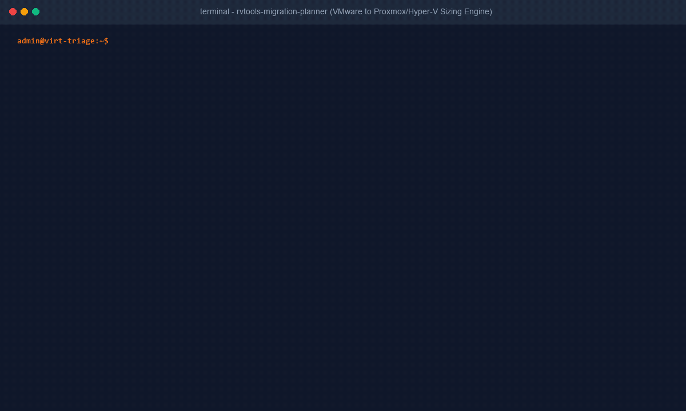

# VMware RVTools to Proxmox / Hyper-V Migration Planner (`rvtools-migration-planner`)



[](https://github.com/ToritsejuBoyo/rvtools-migration-planner/actions/workflows/tests.yml)
[](LICENSE)
[]()
[-brightgreen.svg)](CONTRIBUTING.md)
[](SECURITY.md)
[](https://agentskills.io)

[-blue.svg)](scripts/rvtools_planner.py)

An enterprise virtualization assessment engine and hypervisor exit planner. Ingests native VMware vSphere RVTools multi-tab Excel workbooks (`.xlsx`) or exported CSV directories using standard library Python, pinpoints migration blockers (Raw Device Mappings, stale snapshots, multi-writer shared disks, legacy operating systems, monster VMs), formulates 5-wave phased migration schedules, and sizes destination Proxmox VE (Ceph/ZFS) or Microsoft Hyper-V clusters with deterministic $N+1$ and $N+2$ high availability resilience.

HD Video demonstration available in [`assets/demo.mp4`](assets/demo.mp4).

---

## Non-Technical Executive Overview

### The One-Sentence Pitch
A zero-dependency virtualization assessment engine that turns dense VMware RVTools inventory dumps into actionable Proxmox VE and Microsoft Hyper-V migration blueprints, blocker matrices, and exact hardware sizing bills of materials in seconds.

### The Real-World Problem
Following Broadcom's acquisition of VMware and shift to per-core subscription bundling, enterprises face renewal price increases of 300% to 1,200%, triggering urgent hypervisor exit initiatives. However, manual spreadsheet auditing of hundreds or thousands of virtual machines across multiple RVTools tabs (`vInfo`, `vDisk`, `vSnapshot`, `vNetwork`) is painfully slow and prone to catastrophic blind spots:
1. **Raw Device Mappings (RDMs):** Directly attached physical LUNs that silently fail during live disk conversion.
2. **Stale Snapshots (>72h or >20GB):** Hidden snapshot delta trees that cause hypervisor storage exhaustion or multi-hour cutover outages during disk consolidation.
3. **Shared SCSI Multi-Writer Disks:** Oracle RAC and Windows Failover Clustering shared disks that break when imported as standard standalone virtual disks.
4. **Missing VirtIO Storage Drivers:** Windows Server VMs migrated from VMware Paravirtual SCSI (PVSCSI) to KVM/Proxmox crash immediately on boot with `INACCESSIBLE_BOOT_DEVICE` bluescreens.
5. **Inaccurate Target Sizing:** Infrastructure teams regularly undersize target Ceph storage by ignoring the 3x replication factor and 20% maintenance scrub headroom, or fail to account for $N+1$ host memory failover.

### The 3-Step Walkthrough
1. **Export RVTools Inventory:** An infrastructure engineer exports their existing VMware vSphere cluster to an Excel workbook (`.xlsx`) or CSV folder via standard RVTools.
2. **Run Local Assessment Engine:** The engineer executes `python scripts/rvtools_planner.py -i export.xlsx --target proxmox --sanitize`. The tool ingests all compute, storage, snapshot, and network telemetry offline and scrubs all internal hostnames and IP addresses.
3. **Review Actionable Cutover Deliverables:** The tool generates an executive Markdown report and structured JSON inventory detailing exact blocker remediations, a 5-wave phased cutover schedule, and a node-by-node hardware purchase bill of materials.

### Why IT Leadership Approves
- **Strictly Read-Only Offline Telemetry:** Never connects to or interacts with live production vCenter, ESXi, Proxmox VE, or Hyper-V clusters. Zero risk of service disruption or misconfiguration.
- **Client-Side Data Sanitization (Zero PII Leakage):** Automated `--sanitize` mode masks VM hostnames, datastores, cluster names, and IP addresses using deterministic SHA-256 tokens before any reports are shared or processed by LLMs.
- **Zero Third-Party Dependencies:** Written in 100% pure Python standard library modules (`zipfile`, `xml.etree.ElementTree`, `csv`, `json`, `argparse`). No `pip install`, no compiled binaries, and zero alerts triggered on enterprise EDR or endpoint protection solutions.
- **Conservative Enterprise Sizing Safeguards:** Strictly enforces $N+1$ (or $N+2$) host hardware failover reserves, 75%-80% host RAM caps under failure states, and Ceph 3x storage replication overhead plus 20% dynamic recovery headroom.

---

## Diagnostic & Sizing Capabilities

| Telemetry Dimension | Source RVTools Tab | Migration Constraint / Sizing Computation |
| :--- | :--- | :--- |
| **VM Inventory** | `vInfo` | Active vs powered-off VM filtering; zombie VM detection; compute capacity ($vCPUs$, $vRAM$, provisioned and in-use storage). |
| **Disk Architecture** | `vDisk` | Detection of Raw Device Mappings (`is_rdm`); multi-writer SCSI buses (`sharingMultiWriter`); controller types (PVSCSI, LSI Logic, IDE). |
| **Snapshot Chains** | `vSnapshot` | Delta chain age and size audit; flags snapshots $>72\text{ hours}$ or $>20\text{ GB}$ as critical consolidation blockers. |
| **Network Interfaces** | `vNetwork` | Multi-NIC bindings; IP address tracking; Linux MAC-pinned interface identification (`ens192` to `ens18`). |
| **Host Fleet** | `vHost` | Source ESXi physical core and memory inventory; consolidation ratio benchmarking. |
| **Ceph Storage Math** | Calculated | Computes usable storage ($Storage_{\text{in-use}} \times 1.20$) and raw storage ($Storage_{\text{usable}} \times 3.0$). |
| **Hyper-V Licensing** | Calculated | Enforces Microsoft Windows Server 16-core physical server floor and 2-core pack increment math. |

---

## Phased 5-Wave Cutover Architecture

```
[Wave 0: Decommission & Cleanup] ──► Powered-off and zombie VMs (reclaims storage before purchasing hardware)
[Wave 1: Pilot & Low-Risk]       ──► Stateless dev/test Linux workloads (validates networking, bridge VLANs, PBS)
[Wave 2: Tier-2 Business Apps]   ──► Internal web applications, build runners, non-critical database replicas
[Wave 3: Tier-1 Stateful Core]   ──► Standalone production SQL Server, PostgreSQL, ERP core, domain controllers
[Wave 4: High-Risk & Blockers]   ──► Clustered Oracle RAC, MSCS shared disks, physical RDMs, Monster VMs (vNUMA)
```

---

## Installation & Prerequisites

### Prerequisites
- Python 3.8 or higher.
- Standard operating system: Linux, macOS, or Windows PowerShell.
- Zero external Python package dependencies (no `pip install` required).

### Installation via Git
```bash
git clone https://github.com/ToritsejuBoyo/rvtools-migration-planner.git
cd rvtools-migration-planner
```

### Single Script Usage
```bash
# Ingest native RVTools Excel workbook (.xlsx)
python scripts/rvtools_planner.py \
  --input tests/fixtures/fixture-enterprise-datacenter.xlsx \
  --target proxmox \
  --cores 64 \
  --ram 512 \
  --sanitize \
  --output rvtools-migration-report.md

# Ingest exported CSV directory
python scripts/rvtools_planner.py \
  --input tests/fixtures/fixture-enterprise-datacenter-csv/ \
  --target hyperv \
  --cores 32 \
  --ram 256 \
  --sanitize \
  --json-output rvtools-assessment.json
```

---

## Agent Platform Setup & Integration

### Google Antigravity / AgentSkills.io
Clone or copy this repository into your agent's skills directory:
```bash
git clone https://github.com/ToritsejuBoyo/rvtools-migration-planner.git ~/.gemini/skills/rvtools-migration-planner
```

### Cursor / Claude Code
Reference `SKILL.md` directly in your workspace configuration or `.cursorrules`:
```markdown
When planning VMware vSphere migrations to Proxmox VE or Microsoft Hyper-V, or auditing RVTools exports, activate and adhere to:
skills/rvtools-migration-planner/SKILL.md
```

---

## Hands-On Local Verification & Automated Test Harness

The repository includes a comprehensive 4-tier test harness with 100% synthetic mock datasets:

```bash
# 1. Standard Validation Suite (20 tests)
python tests/validate-skill.py

# 2. High-Volume Scale Benchmark (5,000 VMs)
python tests/stress_test_rvtools_planner.py

# 3. Extreme Malformed Payloads & Security Defense (13 tests)
python tests/extreme_test_rvtools_planner.py

# 4. Advanced Architectural Edge Cases & Sizing Math (8 tests)
python tests/advanced_edge_cases_test.py
```

### Test Coverage

Pass/fail status for every suite is published by CI on each push, across Python
3.9-3.13 on Linux, macOS, and Windows - see the `tests` badge at the top of this file
for the current result rather than a number recorded here by hand.

What the suites cover:
- **Standard harness:** end-to-end assessment against the bundled RVTools fixtures.
- **Scale stress:** 5,000-VM enterprise inventories ingested, analyzed, and sized, with
  a throughput assertion to catch performance regressions.
- **Extreme payloads:** corrupted XLSX, truncated XML, ReDoS resilience, and negative
  hardware inputs.
- **Architectural edge cases:** Ceph 3x storage math, Windows VirtIO warnings, Hyper-V
  core licensing, and RDM blockers.
- **Sanitization conformance:** the library-wide credential and PII redaction contract
  (`tests/sanitizer_conformance_test.py`), identical in every skill.

---

## Repository Structure

```
rvtools-migration-planner/
├── .gitignore
├── LICENSE
├── README.md
├── SKILL.md
├── assets/
│   ├── demo.gif
│   ├── demo.mp4
│   ├── rvtools-migration-plan-template.md
│   └── rvtools-migration-report-template.md
├── build-tools/
│   ├── generate-fixtures.py
│   └── generate-rvtools-demo-media.py
├── references/
│   ├── hypervisor-migration-matrix.md
│   └── rvtools-migration-blockers-and-sizing.md
├── scripts/
│   ├── analyze_rvtools.py
│   └── rvtools_planner.py
└── tests/
    ├── advanced_edge_cases_test.py
    ├── extreme_test_rvtools_planner.py
    ├── stress_test_rvtools_planner.py
    ├── validate-skill.py
    └── fixtures/
        ├── fixture-clean-greenfield-cluster.csv
        ├── fixture-enterprise-datacenter.xlsx
        ├── fixture-enterprise-datacenter-csv/
        ├── fixture-legacy-os-fleet.csv
        ├── fixture-monster-vms-and-clustering.xlsx
        └── fixture-rdm-and-snapshots-blockers.xlsx
```

---

## License

MIT License. Copyright (c) 2026 Toritseju Boyo.
See [`LICENSE`](LICENSE) for complete terms.
